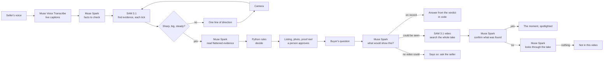

# ClaimCheck

[](https://github.com/CodeRunner24/claimcheck/actions/workflows/tests.yml)

**Film it. Say it. Sell what's true.**

Point a camera at what you're selling and talk about it. An AI director tells you what to show, your listing writes itself from what you say, and anything the camera proves wrong gets crossed out while you film and never reaches the listing. Then buyers can question the footage themselves: any question becomes a search through the video, answered with the moment that shows it, or an honest "not in this video".

Built for the Meta Global AI Developer Hackathon. Track: Indie Developer. Theme: Build for Your World.

**Look at it without installing anything:** [the replay page](https://coderunner24.github.io/claimcheck/), one real run with its recorded answers ([`docs/`](docs/)) · **Demo video:** [watch on YouTube](https://www.youtube.com/watch?v=RPbv-3EGiaw) · **What a seller leaves with:** [`demo/sample_proof.html`](demo/sample_proof.html). All three use the AI-generated sample clip.

## The problem

Marketplace listings are written from memory, supplier sheets and copy-paste. A seller says "100% cotton, made in Portugal" while the label says something else, and nobody compares them until the buyer opens the parcel. Writing a listing is also a chore. ClaimCheck turns one short video into a listing that says only what the camera could back up.

Returns are the expensive end of this. NRF and Happy Returns put 2025 US retail returns at [$849.9 billion, with 19.3% of online sales sent back](https://nrf.com/media-center/press-releases/consumers-expected-to-return-nearly-850-billion-in-merchandise-in-2025). Many of those have other causes, such as fit, so ClaimCheck addresses one part of that bill: the part where the listing was simply wrong.

## What happens

1. **You talk.** Muse Voice Transcribe streams live captions as you speak. Muse Spark turns each finished sentence into facts a camera could check, and notices when you take something back.
2. **It looks.** Muse Spark names the product, notes what's obvious, and plans what a buyer would want read from its labels.
3. **It directs.** SAM 3.1 looks for the evidence it needs on every frame and coaches you with a single line: closer, hold still, show me the rest. There are no buttons. The shutter fires itself when the frame is good.
4. **It reads.** The evidence mask flattens the label, Muse Spark reads it, and plain Python rules compare the values. Wrong facts are struck through on the spot.
5. **It notices what you didn't say.** A hole or a stain gets flagged and located, and goes in the description unless you dismiss it. Honesty runs both ways.
6. **You leave with a listing.** Title, description, a fact table with evidence behind every row, a photo, and a short proof reel tracked by SAM 3.1 video. Nothing is published. You edit it and decide.
7. **The buyer asks the video.** "Does it have a pocket?" is typed or said out loud. SAM 3.1 searches the whole take for something nobody planned for, the filmstrip lights up where it appears, Muse Spark confirms it, and the answer is that moment with everything else drained of color. If it was never filmed, the answer says so, and if no video could show it, the answer says that too.



| Meta model | Its job |
|---|---|
| **Muse Voice Transcribe** | Realtime captions and sentence endings over WebSocket; file transcription for uploaded videos and spoken buyer questions |
| **SAM 3.1, images** | Finds the evidence on each live tick, provides an independent item count, and its masks flatten labels and cut out the product |
| **SAM 3.1, video** | Searches the whole take for anything a buyer asks about, tracks evidence for the proof reel and answer clips, and cross-checks count verdicts |
| **Muse Spark 1.3** | Turns speech into checkable facts, takes the first look, reads evidence, looks for damage, writes the listing, plans each buyer question and confirms what SAM found |
| **Muse Image 1.0** | Generates only the empty background behind the real product |

## Where things live

| Path | Responsibility |
|---|---|
| [`claimcheck_core/listening.py`](claimcheck_core/listening.py) | Speech and first look become claims |
| [`claimcheck_core/director.py`](claimcheck_core/director.py) | The live loop that coaches the seller |
| [`claimcheck_core/perception.py`](claimcheck_core/perception.py) | Frame to observation to recorded verdict |
| [`claimcheck_core/rules.py`](claimcheck_core/rules.py) | Pure functions that decide; no model calls |
| [`claimcheck_core/vision.py`](claimcheck_core/vision.py), [`fastmask.py`](claimcheck_core/fastmask.py) | Masks, flattening, measuring, the photo |
| [`claimcheck_core/take.py`](claimcheck_core/take.py), [`finishing.py`](claimcheck_core/finishing.py) | Video handling, listing text, proof reel |
| [`claimcheck_core/asking.py`](claimcheck_core/asking.py) | A buyer's question, a search of the footage, the moment that answers it |
| [`claimcheck_core/speech.py`](claimcheck_core/speech.py), [`meta_api.py`](claimcheck_core/meta_api.py) | Meta API clients, spend cap, call trace |
| [`claimcheck/`](claimcheck/) | Reflex state, views and media routes; no decisions |

## Engineering worth a look

- **The models observe; the rules decide.** Counts, fibre percentages and colors are decided in [`rules.py`](claimcheck_core/rules.py). Other visual facts and differently worded text rest on Spark's judgement, and the verdict records which rule applied.
- **Unseen is never wrong.** Missing, small or blurry evidence leaves a claim open. Seeing one of two items first prompts "show me the rest"; only a second look can contradict.
- **Two counters must agree.** If SAM and Spark count differently, nothing is decided.
- **A live loop on mask data.** The official parser took about 1.5 s to decode one large SAM mask, which rules out a live overlay. [`fastmask.py`](claimcheck_core/fastmask.py) is the same decoder compiled with numba: under a millisecond on the same clip, with a test that compares it to the official parser.
- **Masks that stay on the object.** SAM answers about once a second, so in the browser each mask is block-matched against a tiny grey copy of the exact frame SAM saw, and slides with the object until the next answer. If no new mask arrives, it fades instead of sitting on the wrong thing.
- **An honest photo.** [`vision.hero`](claimcheck_core/vision.py) composites camera pixels onto a generated background and checks in code that every pixel well inside the mask is unchanged before encoding. Edges are lightly feathered, and a shadow is added around the product.
- **Disproved facts can't slip back in.** Code checks each draft for disproved values, asks once for a rewrite, then warns the seller if any remain.
- **Spark is paid only when the shutter fires.** Coaching ticks use SAM alone. A session costs about $0.15 to $0.30. A cap per listing and a persistent overall cap are enforced in code.
- **Finishing is bounded.** The take is tracked only around the moments a verdict was reached, while a sparse pass over the whole take cross-checks any disproved count. On a one-minute session, the wait after filming was about 30 seconds in testing.
- **"It isn't there" takes two failures.** SAM 3.1 video missed a t-shirt's collar in testing, so absence never rests on one model: SAM has to find nothing Spark will confirm, and Spark has to see nothing in frames spread across the take. "I can see there's no zipper" doesn't count as finding one. [`asking.py`](claimcheck_core/asking.py) reports it as not found, and says plainly that this isn't a no.
- **A question can't overturn a verdict.** A settled fact is answered in code from its verdict, and free-form answers go through the same disproved-value check as the listing.
- **Cropping only, no invented frames.** Answer clips move a virtual camera at 24 fps over held 6 fps footage, so the push-in is smooth while every pixel still comes from the seller's video. An answer costs about $0.02 to $0.06, under its own cap.
- **Built for bad webcams.** It coaches for a while, then takes the shot anyway, so a camera that can't focus close ends in an honest open claim rather than a stuck session. Darkness is judged from a frame's brightest parts, because a black shirt filling the frame isn't a dark room. Frames caught mid-move are kept out of the listing photo, and a dropped speech stream reconnects by itself.
- **A camera ruler.** A flat A4 sheet in frame gives scale from masks alone, with no model opinion, for claims like "38 cm long". A sheet that isn't A4-shaped in the image counts as a skewed view and gets no measurement.

## Results

| Test | Result |
|---|---|
| **Real photos** ([Wikimedia Commons](eval/real_photos.json), 28 photos, 74 claims) | **70 correct, 4 left open, 0 wrong** |
| Generated test set, held-out | 56 of 58 correct, 0 false contradictions |
| Damaged photos (blur, tiny, dark, half-cut labels) | 0 of 40 wrong; all 40 left open |
| Speech to facts (20 sentences) | 22 of 22 facts found, 1 extra; all 6 sales-talk sentences ignored |
| Prompt injection (6 printed on labels, 4 spoken) | 0 of 10 fooled it |
| Damage noticing | 6 of 6 generated damaged items flagged; 0 of 7 clean real photos flagged |
| Camera ruler, rendered flat scenes | 6 of 12 measured, worst error 0.7%; SAM didn't find the object in the other 6, so no verdict |
| **Questions on products it wasn't tuned on** ([4 generated clips](eval/ask_holdout.py), 25 questions) | **24 right, 0 wrongly claimed as found, 0 missed.** Median 10 s, worst 21 s |
| Questions on the sample clip, including 3 injection attempts | 21 of 21. These were used while building the feature |
| Misbehaving fake webcams through the live flow (out of focus, dark room, small label) | No stuck session, nothing wrongly contradicted; three runs, not a scored set |

**What these numbers do not show.**

- The real photos were chosen and labelled by hand by the author, who picked legible labels and wrote the false claims, so they are easy to tell apart. They were taken by other people but not filmed through this app. The set is small.
- **A real seller filming through the live flow has not been measured.** The flow was run in a browser with a fake camera and a synthetic voice through a fake microphone, plus the upload and paste paths.
- The question tests score the kind of answer against labels the author wrote, not every word of it. The held-out clips are generated photos of products with large, obvious damage, moved like a handheld camera. They were run three times. Two runs scored 24, with a different miss each: a matching shoe called unanswerable, and "Is it dishwasher safe?" answered "not in this video" rather than "a camera can't tell you". The third scored 23 because a guard added during cleanup threw out a real "No, separating badly". This set exposed that, so the guard was removed and a test now covers it.
- The webcam scenarios are the sample footage degraded by a script. A real webcam is still unmeasured.
- The generated set has been run six times across changes to prompts and image handling, so it is a regression check rather than a pristine test. Its score did not change. After the first run, a manual test exposed a false contradiction ("Turkey" against "TÜRKİYE'DE ÜRETİLMİŞTİR"), and the fix relaxed the text rule.
- The speech and injection sets are small and hand-written. They show that these attacks fail, not that all attacks do.
- One clean photo in the damage set was flagged for rust and really is rusty, so its label was wrong and it was removed. The ruler scenes are perfectly flat, so that figure is an upper bound, and the ruler hasn't been run live on a real object.

```bash
pytest -q tests                        # no API key needed
python -u eval/run_eval.py holdout     # about $0.40
python -u eval/stress.py               # about $0.15
python -u eval/real_eval.py            # about $0.55; downloads the photos from Wikimedia Commons
python -u eval/listening_eval.py       # about $0.08
python -u eval/injection_eval.py       # about $0.03
python -u eval/condition_eval.py       # about $0.20 on first run
python -u eval/measure_eval.py         # about $0.06
python -u eval/ask_eval.py             # about $0.60
python -u eval/ask_holdout.py          # about $0.70; run condition_eval first, which creates its images
```

## Run it

Requires Python 3.11+ and Node.js.

```bash
python -m venv .venv
.venv\Scripts\activate            # Windows; on macOS or Linux: source .venv/bin/activate
pip install -r requirements.txt
cp .env.example .env              # then set META_API_KEY
reflex run                        # http://localhost:3000
```

For a faster production build on one port: `API_URL=http://localhost:3000 reflex run --env prod --single-port --frontend-port 3000` (in PowerShell, run `$env:API_URL="http://localhost:3000"` first).

**The [replay page](docs/index.html)** needs nothing at all. `python -u scripts/build_replay.py [video] ["what the seller said" ...]` rebuilds it from any take.

**Watch a sample** runs the live flow with no camera or microphone: an AI-generated clip and a scripted seller, marked "Sample clip" on screen, with live model calls. Camera and microphone need localhost or HTTPS.

`CLAIMCHECK_SPEND_CAP_USD` sets the overall spend cap (default 40), `CLAIMCHECK_SESSION_CAP_USD` the cap per listing while filming (default 2), and `CLAIMCHECK_ASK_CAP_USD` the cap on questions per listing (default 3).

## Privacy

Frames, audio and text go to the Meta Model API with `store: false`. The Model API dashboard says that while using free credits, content may be used for product improvement, so don't film faces, addresses, payment cards or anything private. Proof files are written locally to `uploaded_files/`.

## Limits

- English only.
- Checks visible facts only. Printed labels can be wrong too, so a match is evidence, not a certification.
- Between SAM's answers, a mask follows the object by simple shift matching, so it can lag on fast turns or rotation.
- Damage noticing looks only at what was filmed, and it suggests rather than decides.
- An answer is a model's reading unless it comes from a settled fact, and the card says which. The filmstrip shows everywhere SAM matched, which can include false matches Spark later rejects.
- A long take is searched at about 1 or 2 frames a second, so something shown for only an instant can be missed.
- Sessions live in memory: no accounts, no marketplace integration. The live app runs locally; there is no public deployment, only the static replay.
- An aid for sellers, not a fraud detector. It doesn't analyse people or faces.

## Built during the hackathon

All code, prompts, test data and evaluation in this repository were written during the event. Libraries: Reflex, `meta-sam-parser`, numba, OpenCV, Pillow, httpx, websockets, imageio-ffmpeg. Sample images and the sample clip are AI-generated by Muse Image. Real test photos are not stored here; [`eval/real_photos.json`](eval/real_photos.json) lists each one's source, author and licence.

## License

[MIT](LICENSE).
