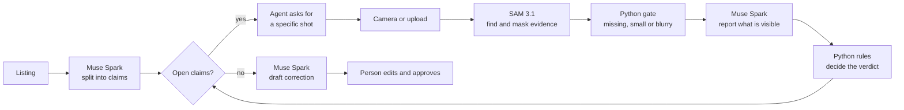

# ClaimCheck

**Fix the listing before the buyer finds out.**

ClaimCheck turns a product listing into claims a camera can prove, then directs the seller's camera until each claim is verified, contradicted, or honestly left open. A person approves every correction.

Built for the Meta Global AI Developer Hackathon. Track: Indie Developer. Theme: Build for Your World.

**Demo video:** [`demo/claimcheck_demo.mp4`](demo/claimcheck_demo.mp4)

## The problem

Marketplace listings are written from memory, supplier sheets and copy-paste. A seller can say "100% cotton, made in Portugal" while the label on the shirt says something else, and often nobody compares them until the buyer opens the parcel. ClaimCheck makes that comparison a short conversation with a camera.

## How it works



| Meta model | Job in ClaimCheck |
|---|---|
| **Muse Spark 1.3** | Splits a listing into checkable claims, reads crops, drafts the correction |
| **SAM 3.1** | Finds and masks the evidence, and provides an independent item count |
| **Muse Image 1.0** | Draws an instructional shot guide, and generated the disclosed test images |

Design choices:

- **The models observe; the rules decide.** Spark reports what it sees before [`rules.py`](claimcheck_core/rules.py) compares values. Counts, fibre percentages and colors are decided in plain Python. Other visual facts and text in other wording rest on Spark's judgement, and the rule name on the verdict shows that.
- **Unseen is never a contradiction.** Missing, small or blurry evidence returns "Need evidence" and a specific next shot.
- **One item in frame is not yet a lie.** Seeing fewer items than claimed triggers a request to show them all. Only a second look can contradict.
- **Two counters must agree.** If SAM and Spark count differently, the agent asks the seller to separate the items.
- **Settled claims cost nothing more.** Each new shot checks only the open claims.
- **Hard spend cap.** Every API call goes through a persistent ledger with a limit in code.
- **Listings and label text are untrusted.** Prompts treat them as data. This reduces prompt-injection risk but has not been adversarially tested.

## Results

Run with `python -u eval/run_eval.py holdout` and `python -u eval/stress.py`. Raw outputs are in [`eval/`](eval/).

| Test | Result |
|---|---|
| Held-out claims correct | **56 / 58** on 25 images |
| False contradictions | **0** |
| Contradictions caught | 26 of 27 (precision 1.0, recall 0.963) |
| The two misses | One image where SAM and Spark disagreed on a count, so the agent abstained and asked for a re-shoot |
| Damaged photos (blur, tiny, dark, half-cut labels) | **0 of 40 wrong**; all 40 abstained |
| Median time per claim | 6.8 s |
| Cost per claim | about $0.006 |

**What these numbers do not show.** All test images were generated by Muse Image and checked by eye. They are clean and the sample is small, so **performance on real phone photos has not been measured**. The evaluation also tests verdicts on prepared claims, not claim extraction. The holdout was run twice: after the first run, a manual Turkish test exposed a false contradiction ("Turkey" against "TÜRKİYE'DE ÜRETİLMİŞTİR"). The fix relaxed the text rule, and the holdout score did not change. Add your own photos through `eval/cases_extra.json`.

## Run it

Requires Python 3.11+ and Node.js.

```bash
python -m venv .venv
.venv\Scripts\activate            # Windows; on macOS or Linux: source .venv/bin/activate
pip install -r requirements.txt
cp .env.example .env              # then set META_API_KEY
reflex run                        # http://localhost:3000
```

Try the default listing with the three sample shots, the camera, or an upload. Sample shots are AI-generated. Camera access requires localhost or HTTPS.

```bash
pytest -q tests                        # rule tests, no API key
python -u eval/run_eval.py holdout     # about $0.35 in API calls
python -u eval/stress.py               # about $0.15
```

`CLAIMCHECK_SPEND_CAP_USD` sets the spend cap (default 40). Model calls use Standard mode with `store: false`.

## Limits

- Checks visible facts only. Printed labels can be wrong too, so a match is evidence, not proof or certification.
- Photos can't establish fibre content or origin beyond what the label says.
- Works frame by frame. SAM 3.1 video tracking is not used yet.
- Sessions live in memory: no accounts, no marketplace integration.
- This is an aid for sellers, not a fraud detector. It doesn't analyse people or faces.

## Built during the hackathon

All code, prompts, test data and evaluation in this repository were written during the event. Libraries used: Reflex, `meta-sam-parser`, OpenCV, Pillow, httpx.
