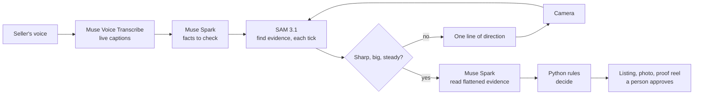

# ClaimCheck

**Film it. Say it. Sell what's true.**

Point a camera at what you're selling and talk about it. An AI director tells you what to show, your listing writes itself from what you say, and anything the camera proves wrong gets crossed out while you film and never reaches the listing.

Built for the Meta Global AI Developer Hackathon. Track: Indie Developer. Theme: Build for Your World.

**Demo video:** [`demo/claimcheck_demo.mp4`](demo/claimcheck_demo.mp4)

## The problem

Marketplace listings are written from memory, supplier sheets and copy-paste. A seller says "100% cotton, made in Portugal" while the label says something else, and nobody compares them until the buyer opens the parcel. Writing a listing is also a chore. ClaimCheck turns one short video into a listing that says only what the camera could back up.

## What happens

1. **You talk.** Muse Voice Transcribe streams live captions as you speak. Muse Spark turns each finished sentence into facts a camera could check, and notices when you take something back.
2. **It looks.** Muse Spark names the product, notes what's obvious, and plans what a buyer would want read from its labels.
3. **It directs.** SAM 3.1 looks for the evidence it needs on every frame and coaches you with a single line: closer, hold still, show me the rest. There are no buttons. The shutter fires itself when the frame is good.
4. **It reads.** The evidence mask flattens the label, Muse Spark reads it, and plain Python rules compare the values. Wrong facts are struck through on the spot.
5. **You leave with a listing.** Title, description, a fact table with evidence behind every row, a photo, and a short proof reel tracked by SAM 3.1 video. Nothing is published. You edit it and decide.



| Meta model | Its job |
|---|---|
| **Muse Voice Transcribe** | Realtime captions and sentence endings over WebSocket; file transcription for uploaded videos |
| **SAM 3.1, images** | Finds the evidence on each live tick, provides an independent item count, and its masks flatten labels and cut out the product |
| **SAM 3.1, video** | Tracks evidence through the whole take for the proof reel, and cross-checks count verdicts across every frame |
| **Muse Spark 1.3** | Turns speech into checkable facts, takes the first look, reads evidence, writes the listing |
| **Muse Image 1.0** | Generates only the empty background behind the real product |

## Engineering worth a look

- **The models observe; the rules decide.** Counts, fibre percentages and colors are decided in [`rules.py`](claimcheck_core/rules.py). Other visual facts and differently worded text rest on Spark's judgement, and the verdict records which rule applied.
- **Unseen is never wrong.** Missing, small or blurry evidence leaves a claim open. Seeing one of two items first prompts "show me the rest"; only a second look can contradict.
- **Two counters must agree.** If SAM and Spark count differently, nothing is decided.
- **A live loop on mask data.** The official parser took about 1.5 s to decode one large SAM mask, which rules out a live overlay. [`fastmask.py`](claimcheck_core/fastmask.py) is the same decoder compiled with numba: under a millisecond on the same clip, with a test that compares it to the official parser.
- **An honest photo.** [`vision.hero`](claimcheck_core/vision.py) composites camera pixels onto a generated background and checks in code that every pixel well inside the mask is unchanged before encoding. Edges are lightly feathered, and a shadow is added around the product.
- **Disproved facts can't slip back in.** Code checks each draft for disproved values, asks once for a rewrite, then warns the seller if any remain.
- **Spark is paid only when the shutter fires.** Coaching ticks use SAM alone. A session costs about $0.15 to $0.30, and a persistent spend cap sits in the API client.
- **A camera ruler.** A flat A4 sheet in frame gives scale from masks alone, with no model opinion, for claims like "38 cm long". A sheet that isn't A4-shaped in the image counts as a skewed view and gets no measurement.

## Results

| Test | Result |
|---|---|
| Held-out claims correct | **56 / 58** on 25 images |
| False contradictions | **0** |
| Contradictions caught | 26 of 27 |
| The two misses | One image where SAM and Spark disagreed on a count, so it abstained |
| Damaged photos (blur, tiny, dark, half-cut labels) | **0 of 40 wrong**; all 40 abstained |
| Camera ruler, rendered flat scenes | 6 of 12 scenes measured, worst error 0.7%; SAM didn't find the object in the other 6, so no verdict |

**What these numbers do not show.** All test images are AI-generated or rendered, clean, and few. **Performance on real phone footage has not been measured.** The ruler scenes are perfectly flat, so treat that figure as an upper bound; it hasn't been run through the live flow on a real object. Claim extraction from speech is not scored. The holdout has now been run four times across changes to prompts and image handling, so it is a regression check rather than a pristine test; the score did not change. After the first run, a manual test exposed a false contradiction ("Turkey" against "TÜRKİYE'DE ÜRETİLMİŞTİR"), and the fix relaxed the text rule.

The whole flow was run in a browser with a fake camera and a synthetic voice through a fake microphone, plus the upload and paste paths. A real camera, real microphone and real product are untested at the time of writing.

```bash
pytest -q tests                        # no API key needed
python -u eval/run_eval.py holdout     # about $0.40
python -u eval/stress.py               # about $0.15
python -u eval/measure_eval.py         # about $0.06
```

## Run it

Requires Python 3.11+ and Node.js.

```bash
python -m venv .venv
.venv\Scripts\activate            # Windows; on macOS or Linux: source .venv/bin/activate
pip install -r requirements.txt
cp .env.example .env              # then set META_API_KEY
reflex run                        # http://localhost:3000
```

**Watch a sample** runs the live flow with no camera or microphone: an AI-generated clip and a scripted seller, labelled on screen, with live model calls. Camera and microphone need localhost or HTTPS.

`CLAIMCHECK_SPEND_CAP_USD` sets the spend cap (default 40).

## Privacy

Frames, audio and text go to the Meta Model API with `store: false`. The Model API dashboard says that while using free credits, content may be used for product improvement, so don't film faces, addresses, payment cards or anything private. Proof files are written locally to `uploaded_files/`.

## Limits

- English only.
- Checks visible facts only. Printed labels can be wrong too, so a match is evidence, not a certification.
- Listings and label text are treated as data in prompts. This reduces prompt-injection risk but has not been adversarially tested.
- Live overlays update about once a second, not at video rate.
- Sessions live in memory: no accounts, no marketplace integration. It runs locally; there is no public deployment.
- An aid for sellers, not a fraud detector. It doesn't analyse people or faces.

## Built during the hackathon

All code, prompts, test data and evaluation in this repository were written during the event. Libraries: Reflex, `meta-sam-parser`, numba, OpenCV, Pillow, httpx, websockets, imageio-ffmpeg. Sample images and the sample clip are AI-generated by Muse Image.
